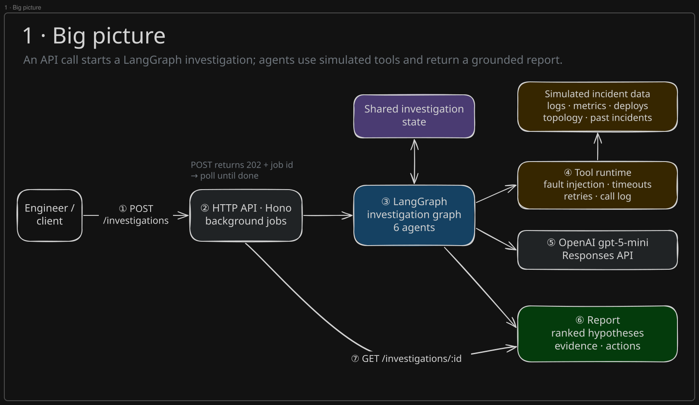
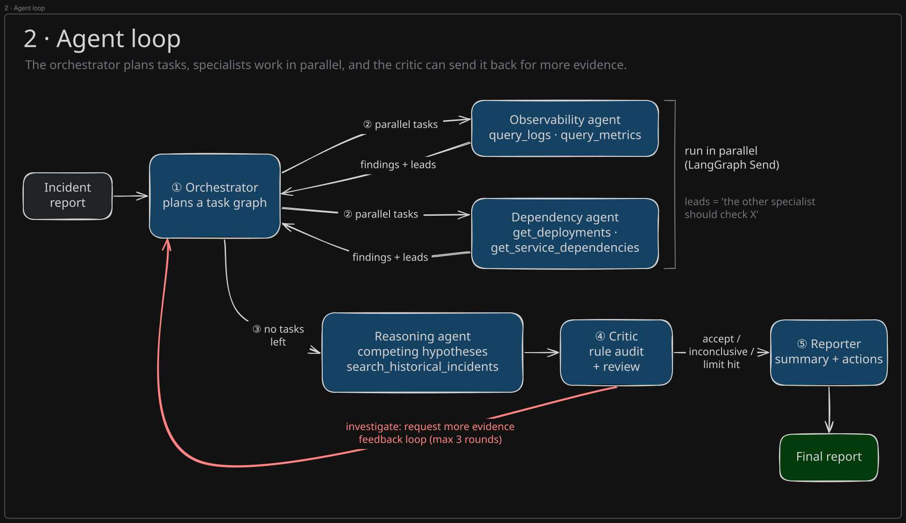
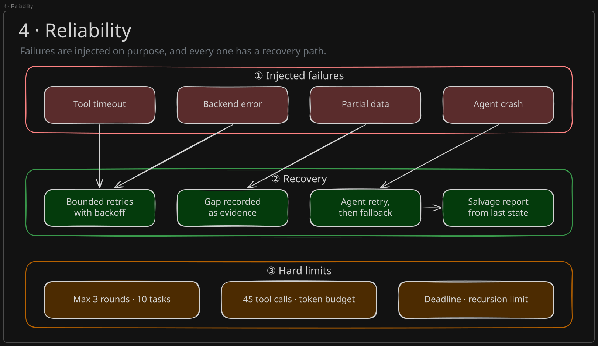
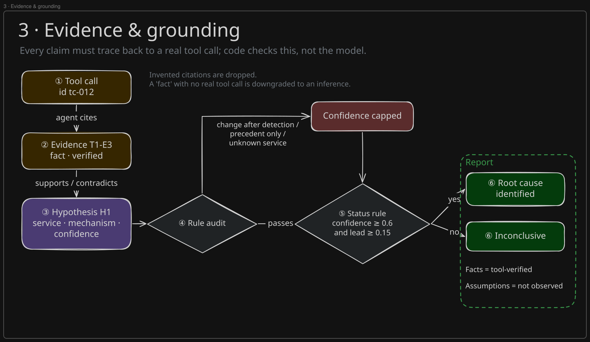
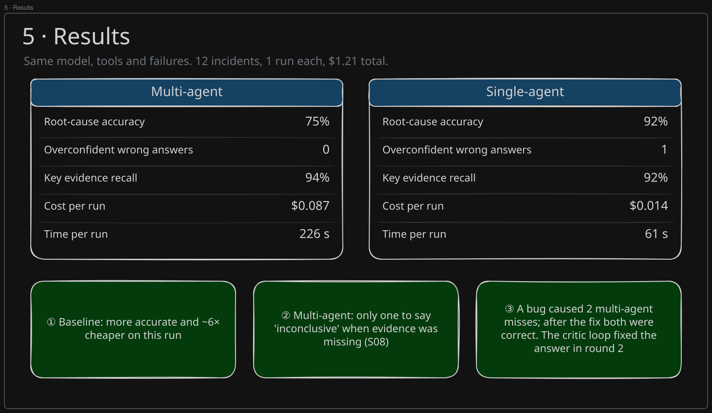

# Orange: multi-agent incident investigation

A multi-agent system, built on [LangGraph](https://langchain-ai.github.io/langgraphjs/), that investigates production incidents. It gathers evidence from logs, metrics, deployment history, service dependencies and past postmortems, weighs competing root-cause hypotheses, challenges them, and writes an evidence-backed report. When the evidence can't settle the question, it says so.

The repo also contains 12 simulated incidents (with misleading evidence, conflicting signals and injected tool/agent failures) and an evaluation harness that compares the multi-agent system against a single-agent baseline using the same model and tools.

## Quick start

```bash
pnpm install
pnpm dev          # API on http://localhost:3000 (pnpm start without file watching)
pnpm test         # offline: scripted model, no API calls
```

Set `OPENAI_API_KEY` in the environment or in a `.env` file (gitignored, loaded on startup). Other settings: `PORT` (default 3000), `INCIDENT_MODEL` (default `gpt-5-mini`), `MAX_CONCURRENT_JOBS` (default 4) and `LOG_LEVEL` (`debug`, `info`, `warn`).

## API

Investigations take minutes, so they run as background jobs: `POST` returns `202` with a `Location` header, and you poll the job until `status` is `succeeded` or `failed`.

| Method | Route | Purpose |
| --- | --- | --- |
| `GET` | `/health` | Status, default model, running jobs |
| `GET` | `/scenarios` | The 12 test incidents |
| `GET` | `/scenarios/:id?include=truth` | Incident, injected faults, and (opt-in) ground truth |
| `POST` | `/investigations` | Start one investigation: `{ scenarioId, system?: "multi-agent" \| "single-agent", model? }` |
| `GET` | `/investigations` | All investigation jobs with outcome summaries |
| `GET` | `/investigations/:id?include=trace` | Job status, report, score and metrics; `trace` adds tasks, evidence, tool calls and critiques |
| `GET` | `/investigations/:id/report` | The report as Markdown |
| `POST` | `/evaluations` | Compare systems: `{ scenarioIds?, systems?, trials?: 1-5, concurrency?: 1-8, model? }` (defaults: all scenarios, both systems) |
| `GET` | `/evaluations` | All evaluation jobs with summaries |
| `GET` | `/evaluations/:id` | Progress (`completed/total`), per-run records, per-system summaries |
| `GET` | `/evaluations/:id/report` | The comparison as Markdown |

```bash
curl -s -X POST localhost:3000/investigations \
  -H 'content-type: application/json' \
  -d '{"scenarioId": "S07", "system": "multi-agent"}'
# → 202 {"id": "inv_3f9c2a1b", "status": "running", ...}

curl -s localhost:3000/investigations/inv_3f9c2a1b
curl -s localhost:3000/investigations/inv_3f9c2a1b/report

curl -s -X POST localhost:3000/evaluations \
  -H 'content-type: application/json' \
  -d '{"scenarioIds": ["S01", "S08"], "trials": 3}'
```

Errors are JSON: `400` with validation `issues`, `404` for unknown scenarios or jobs, `409` when a report is requested before the job finishes, and `429` when `MAX_CONCURRENT_JOBS` jobs are already running. Jobs are kept in memory, so they're lost when the server restarts.

## Architecture





| Agent | Role | Tools | Produces |
| --- | --- | --- | --- |
| **Orchestrator** | Plans a task DAG, reviews specialists' leads, turns critic requests into new tasks, dispatches ready tasks in parallel | — | `InvestigationTask[]` with dependencies |
| **Observability** | What is failing, where, since when | `query_logs`, `query_metrics` | Evidence + gaps + leads |
| **Dependency** | What changed, how faults propagate | `get_deployments`, `get_service_dependencies` | Evidence + gaps + leads |
| **Reasoning** | Builds and ranks competing hypotheses; checks precedent | `search_historical_incidents` | Ranked hypotheses citing evidence IDs |
| **Critic** | Rule-based audit plus model review; recalibrates confidence; requests evidence or stops | — | Verdict, challenges, follow-up requests |
| **Reporter** | Executive summary and remediation plan | — | Narrative + actions (structure is assembled deterministically) |

### How the agents collaborate

The agents don't form a fixed chain of prompts. They coordinate through shared state (`src/graph/state.ts`), and each one's structured output changes what the others do next:

- **Task DAG.** The orchestrator plans tasks with `dependsOn` edges. Independent tasks fan out in parallel through LangGraph `Send`. A dependent task gets the findings and evidence of the tasks it depends on in its prompt; for example, an observability task checks the services the dependency agent found had recently changed.
- **Leads.** Specialists return `leads` for things that need tools they don't have. Once a wave finishes, the orchestrator reviews them and may schedule new tasks for the other specialist.
- **Critic feedback loop.** The critic either accepts, declares the case inconclusive, or asks for specific evidence. Requests go back to the orchestrator, which deduplicates them against existing work and schedules a new round. Reasoning then revises its hypotheses using the new evidence and the critique.
- **Evidence IDs as the shared language.** Every tool call gets a `callId`. Specialists cite call IDs, the system assigns evidence IDs (`T2-E1`), hypotheses cite evidence IDs, the critic's audit resolves those IDs back to tool calls, and the report renders them.

Reducers make concurrent writes safe: tasks are upserted by ID, and evidence and tool calls are append-only and deduplicated.

## Reliability



| Mechanism | Where |
| --- | --- |
| Parallel execution of independent tasks (`Send`, up to `maxParallelTasks` per wave) | `graph/routing.ts`, `agents/orchestrator/scheduler.ts` |
| Task dependencies; a failed dependency doesn't block dependents (they're told it failed) | `scheduler.ts` |
| Tool timeouts (per attempt), bounded retries with backoff for retryable errors, global call budget | `tools/runtime.ts` |
| Simulated failures: timeouts, backend errors, partial results (missing shards), metric gaps | `tools/faults.ts`, scenario `toolFaults` |
| Agent retries (`agentRetries`), then a degraded but valid state update | `agents/recovery.ts` |
| Agent loop limits: `maxAgentTurns` plus grace turns to submit; tool calls refused once the turn or tool budget is spent | `llm/tool-loop.ts` |
| Global limits: `maxRounds`, `maxTasks`, `maxTotalTokens`, `deadlineMs`, LangGraph `recursionLimit` | `config.ts`, `agents/context.ts` |
| Chaos injection: selected agents crash on their first model calls | `llm/chaos.ts`, scenario `agentFaults` |

Each failure has a recovery path:

- **Failed tool call:** the agent sees a structured error (`TIMEOUT`, `UNAVAILABLE`, `NOT_FOUND`, `INVALID_INPUT`, `BUDGET_EXHAUSTED`) and can adapt, or record a `gap` that later agents treat as real evidence.
- **Failed specialist:** its task is marked failed and the gap is recorded.
- **Failed orchestrator:** a deterministic plan is used instead (default plan, accepting leads directly, or following the critic's requests directly).
- **Failed reasoning:** the previous hypotheses are kept.
- **Failed critic:** the verdict comes from the rule-based audit alone.
- **Failed reporter:** a deterministic narrative is written.
- **Graph error:** a report is salvaged from the last state.

Termination reasons are recorded in the report (`critic_accepted`, `max_rounds`, `token_budget_exhausted`, …).

## Evidence, facts and inconclusive outcomes



- **Grounding.** A model-submitted observation becomes `Evidence` only through `registerObservations`. Citations to unknown tool calls are dropped and counted. A "fact" with no valid citation is downgraded to an inference. Evidence backed only by partial data is marked `partial`. A failed call is accepted as proof of a data gap.
- **Critic audit (rule-based, not model judgment).** Flags hypotheses that have no verified support, rest only on historical precedent, are contradicted by more verified facts than support them, blame a change made after detection, blame a change that isn't in the change log, name an unknown service, or have failed queries against the suspect. Several flags cap confidence. The caps apply after the critic model's own adjustments.
- **Facts vs. assumptions.** The report lists tool-verified facts separately from assumptions: hypotheses' stated assumptions plus any inference-only support for the top hypothesis.
- **Inconclusive.** One policy (`report/status.ts`) applies to both systems. The result is inconclusive if the investigation says so, if the top confidence is below 0.6, or if the runner-up is within 0.15. A confident but poorly supported answer gets downgraded.
- **Deterministic assembly.** Agents write the summary and actions. Ranked hypotheses, evidence references and facts are assembled from state, so every reference in the report resolves to a ledger-checked item.

## Tools

All tools take zod-validated input and return a `ToolEnvelope { callId, status: ok | partial | error, data?, partial?, error? }`.

| Tool | Input | Output |
| --- | --- | --- |
| `query_logs` | service, min_level, contains, start, end, limit | Message patterns (grouped, counted, first/last seen) + recent samples |
| `query_metrics` | service, metric?, start, end | Per-metric baseline/min/max/latest, detected anomalies, missing-data ranges; ≤24 points when a metric is named |
| `get_deployments` | service?, types?, start, end | Deploys, config, feature-flag, infra and migration changes |
| `get_service_dependencies` | service, direction, depth | Services and edges (protocol, criticality, notes) |
| `search_historical_incidents` | query, services?, limit | Similar postmortems with a similarity score |

## Test incidents

12 scenarios on a shared fictional e-commerce topology (23 components). Logs and metrics are generated deterministically from compact definitions in `src/scenarios/catalog/`.

| ID | Scenario | Trap |
| --- | --- | --- |
| S01 | payment-pool-regression | Reporter blames the DB; a past incident agrees; a release silently shrank the pool |
| S02 | orders-db-disk-full | A deploy 4 minutes before onset is a red herring; the disk filled |
| S03 | search-feature-flag | Reporter and a precedent blame Elasticsearch; a flag rollout saturated CPU |
| S04 | payment-provider-outage | External processor failing; an unrelated deploy invites blame |
| S05 | jwt-key-rotation | Log search times out twice, then returns 40% of the data |
| S06 | inventory-memory-leak | Error-rate panel reads "0%" because the exporter is down; logs show OOMs |
| S07 | redis-maxmemory-cascade | Fault surfaces 4 hops away; the suspected frontend deploy came after onset |
| S08 | delayed-emails-inconclusive | Logs unavailable and provider has no telemetry: the right answer is **inconclusive** |
| S09 | fulfillment-sync-call | Looks exactly like a known Kafka disk incident; it's a slow synchronous call |
| S10 | migration-lock | Deploy tracker errors and orders-db metrics time out |
| S11 | scraper-traffic | Harmless deploy 23 minutes earlier; actually unthrottled bot traffic |
| S12 | expired-certificate | Health checks green, 0% errors; two agents crash once each |

Each scenario has a ground truth: the root-cause services, a mechanism pattern, an expected outcome, and the key evidence a good investigation should surface. `test/scenarios.test.ts` checks that the key evidence actually exists in each generated dataset.

## Evaluation



`POST /evaluations` runs every scenario through both systems with the same model, tool runtime, injected faults, evidence validation, report assembly and status policy. The baseline (`src/baseline/`) is one agent with all five tools, the same evidence discipline in its prompt, and a turn budget comparable to the multi-agent total. When a scenario injects agent crashes, the baseline also crashes once.

| Metric | Definition |
| --- | --- |
| Root-cause accuracy | Correct outcome, and for identifiable incidents the top hypothesis names a true root-cause service and matches the mechanism pattern |
| Partial credit / top-3 | True cause ranked but not concluded |
| Overconfident wrong | Declared a root cause that is wrong, or declared one when the answer is inconclusive |
| Grounded citation rate | Share of evidence cited by hypotheses that is backed by a real tool call |
| Key evidence recall | Share of the scenario's key signals mentioned in the report's evidence |
| Invalid citations | Citations to tool calls or evidence that don't exist |
| Tool calls, failed tool calls | From the tool ledger |
| LLM calls, tokens, est. cost | From telemetry (prompt incl. cache reads/writes + output) |
| Latency | Wall clock per investigation |

Results come back from `GET /evaluations/:id`, and the comparison tables from `GET /evaluations/:id/report`.

The latest live results (gpt-5-mini, all 12 incidents) and their analysis are in [docs/evaluation.md](docs/evaluation.md). Key decisions, trade-offs, limitations and next steps are summarized in [docs/technical-note.md](docs/technical-note.md).

## Project structure

```
src/
  agents/          one folder per agent: node, prompt, schema (+ scheduler, audit)
    shared/        cross-agent zod schemas and prompt renderers
    context.ts     run context passed through LangGraph runtime context
    recovery.ts    bounded agent retries
  baseline/        single-agent baseline
  core/            domain types and pure logic: evidence, hypotheses, tasks, errors
  evaluation/      scoring, runner, summary
  graph/           LangGraph state, reducers, routing, graph
  investigation/   run wiring and result types for both systems
  llm/             OpenAI client, telemetry, chaos, tool loop, structured output
  report/          status policy, report assembly, markdown
  scenarios/       scenario model, generators, shared world, catalog of 12 incidents
  server/          Hono API: app, routes, background jobs, request schemas
  tools/           tool definitions and the fault-injecting runtime
test/              unit tests plus end-to-end graph tests with a scripted model
```

## Model usage

- Model calls go through the official `openai` SDK and the Responses API, behind a small provider-neutral `LlmClient` interface that tests replace with a scripted client.
- The default model is `gpt-5-mini`, a reasoning model chosen for cost. Costs are estimated from per-model prices in `src/llm/models.ts`. `gpt-5.4-mini` is a stronger option at about 3× the price.
- Requests use `store: false`. Reasoning items are passed back between turns as encrypted content, so agents keep their reasoning across tool calls without OpenAI retaining the conversation.
- Final outputs use strict function schemas (tool loops) or strict JSON-schema structured outputs (single-call agents); zod validates both.
- Reasoning effort is set per agent in `config.ts`: reasoning and the baseline `medium`, everything else `low`.
- Prompt caching is automatic; a per-agent `prompt_cache_key` improves cache hits.

## How this was built

The project was built with AI assistance (Claude Code). [docs/prompt-playbook.md](docs/prompt-playbook.md) is a retrospective: the prompts I'd use to drive the same build again.

## Limitations

- Mechanism matching uses regex patterns, so a correct answer phrased unusually can be scored wrong. Use several trials, and read the per-scenario table in the evaluation report.
- Grounding checks that cited tool calls exist and succeeded. It doesn't check that the claim faithfully reflects the tool output.
- The incidents are simulated. They're designed to be adversarial, but they're far smaller than real telemetry.
