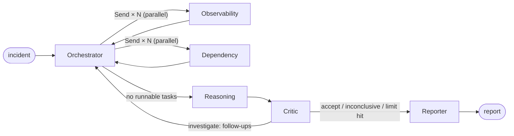

# Building Orange with AI

> **Note:** Reconstructed from memory and the git history. The original chats weren't saved, so these aren't word-for-word.

These are the conversations I had with Claude (in Claude Code) while building Orange, roughly in the order they happened. I've trimmed the long code dumps and kept the parts where a decision got made or something went wrong.

| # | Conversation | What came out of it |
| --- | --- | --- |
| 1 | [Where do I even start](#1-where-do-i-even-start) | Simulated data, ground truth, evaluate from day one |
| 2 | [Picking the stack](#2-picking-the-stack) | TypeScript, LangGraph JS, Hono, zod |
| 3 | [How many agents is too many](#3-how-many-agents-is-too-many) | Six roles, task DAG, leads, critic loop |
| 4 | [Faking a production world](#4-faking-a-production-world) | Shared topology, 12 scenarios with traps |
| 5 | [Tools that break on purpose](#5-tools-that-break-on-purpose) | Five tools, one envelope, fault injection |
| 6 | [Plugging in the model](#6-plugging-in-the-model) | `LlmClient`, Responses API, `store: false`, gpt-5-mini |
| 7 | [Fighting strict schemas](#7-fighting-strict-schemas) | Strict-schema adapter, submit loop, grace turns |
| 8 | ["It made up a log line"](#8-it-made-up-a-log-line) | Call IDs, evidence ledger, grounding |
| 9 | [The critic that agreed with everything](#9-the-critic-that-agreed-with-everything) | Rule-based audit, status policy |
| 10 | [When things crash](#10-when-things-crash) | Retries, fallbacks, chaos injection, hard limits |
| 11 | [A fair fight](#11-a-fair-fight) | Single-agent baseline, metrics |
| 12 | [Tests that don't cost money](#12-tests-that-dont-cost-money) | Scripted model, end-to-end graph test |
| 13 | [The API](#13-the-api) | Background jobs, polling, error shapes |
| 14 | [First live eval (ouch)](#14-first-live-eval-ouch) | 75% vs 92%, a schema bug, a spot check |
| 15 | [Writing it up honestly](#15-writing-it-up-honestly) | Evaluation doc, technical note, diagrams |

---

## 1. Where do I even start

**Me:** ok so I want to build a multi-agent thing that investigates production incidents. like someone gets paged, and the system goes through logs, metrics, recent deploys and tells you what actually broke. I obviously don't have access to real prod data. where do I even start

**Claude:** There are three things to settle before writing any agent code, because they shape everything else.

1. **Where the data comes from.** Without real telemetry you'll need a simulated environment: a fake service topology, plus incidents that come with logs, metrics and deploy history. The upside is that you know the true root cause of every incident, so you can actually score the system.
2. **How you'll know it works.** Plan the evaluation now. Each incident needs a known answer, and the system needs to produce something checkable, like a root-cause service and a mechanism, not just a nice paragraph.
3. **What "multi-agent" buys you.** Build a single-agent version too. Without it you can't tell whether the extra agents are helping or just costing more.

I'd go in this order: scenario format and ground truth → tools over the simulated data → one agent end to end → split into agents → evaluation.

**Me:** makes sense. the incidents shouldn't be easy though. in real incidents the person who reports it is usually wrong about the cause lol

**Claude:** That's a good principle to build in on purpose. Give every scenario at least one trap and tag it, so you can slice the results by trap later:

- a misleading report (on-call blames the wrong thing)
- a red-herring change (a deploy that happens near the onset but isn't the cause)
- a misleading precedent (a past postmortem that looks similar)
- tool failures (timeouts, partial data)
- conflicting signals (a dashboard says healthy, logs say otherwise)

**Me:** can I have one where the right answer is basically "we can't tell"? every AI demo always confidently gives an answer

**Claude:** Yes, and I'd make it a first-class outcome. The ground truth can be `inconclusive`, and the scoring should count "overconfident wrong" separately from plain wrong. A system that always names a root cause will fail that scenario, which is exactly what you want to catch.

---

## 2. Picking the stack

**Me:** doing this in typescript. I know python is the default for agent stuff but I'm way faster in TS. langgraph or should I just write the loop myself?

**Claude:** Both would work. Honestly, for a straight pipeline a hand-written loop is less code. LangGraph earns its place when you need:

- parallel fan-out (`Send`), so several specialists can run at once
- reducers, so their concurrent writes merge into shared state safely
- conditional edges for loops, like a critic sending the team back for more evidence
- a recursion limit as a last-resort safety net

If you're planning parallel specialists and a feedback loop, I'd use LangGraph JS.

**Me:** yeah there'll be parallel stuff. langgraph it is. I usually start from antfu's starter-ts (pnpm, tsdown, vitest, eslint), that ok?

**Claude:** That's fine. I'd add zod for every schema, both tool inputs and agent outputs, and keep the LLM provider behind a small interface of your own so tests can swap in a fake model. For the HTTP layer, something light like Hono.

**Me:** why hono over express

**Claude:** It's smaller and typed, and `app.request()` lets you call routes in tests (or from a script) without starting a server. Express would be fine too. It's not a big decision.

---

## 3. How many agents is too many

**Me:** ok agents. my first list was like 8: logs agent, metrics agent, deploys agent, dependency agent, history agent, hypothesis agent, critic, reporter. too much?

**Claude:** Probably. Every agent is another prompt to maintain, more failure modes and more tokens. I'd split by the question being answered rather than by tool:

| Agent | Question | Tools |
| --- | --- | --- |
| Orchestrator | What should we look at next? | none |
| Observability | What is failing, where, since when? | `query_logs`, `query_metrics` |
| Dependency | What changed, and how does a fault propagate? | `get_deployments`, `get_service_dependencies` |
| Reasoning | Which explanations fit, ranked? | `search_historical_incidents` |
| Critic | What's weak or missing? | none |
| Reporter | What do we tell people and do? | none |

**Me:** but isn't this just a chain of prompts with extra steps. obs → deps → reasoning → critic → report

**Claude:** It is if you wire it like that, and that's a fair challenge. To make the agents actually depend on each other:

- **Task DAG.** The orchestrator plans tasks with `dependsOn` edges. Independent tasks run in parallel. A dependent task gets the findings of the tasks it depends on, so the observability agent can check the services the dependency agent found had recently changed.
- **Leads.** Specialists return leads for things they can't check with their own tools. After each wave, the orchestrator reviews the leads and may schedule tasks for the other specialist.
- **Critic loop.** The critic either accepts, declares the case inconclusive, or asks for specific evidence. Those requests go back to the orchestrator, which schedules a new round.

Then the number of rounds depends on the evidence, not on a fixed pipeline. Roughly:



**Me:** ok I like the leads idea. how do two specialists running at the same time not overwrite each other's state though

**Claude:** Reducers on the state channels. Tasks are upserted by ID, and evidence and tool calls are append-only and deduplicated by ID. Each parallel branch only returns its own additions, so the merge is safe no matter which one finishes first.

---

## 4. Faking a production world

**Me:** let's do the fake world. how big should it be

**Claude:** Big enough that there are plausible wrong answers, and small enough to define by hand. I'd suggest one shared e-commerce topology of around 20-25 components (gateway, frontend, checkout, payment, orders, databases, Redis, Kafka, plus external things like the payment processor and email provider) that every scenario reuses.

Each scenario then only defines what's special about it: the incident report, the changes, a few log patterns, metric effects and the ground truth. Everything else gets generated deterministically from a seed, including background noise logs, so the relevant lines aren't the only lines.

**Me:** show me the shape of one. use the payments one: a release renamed a config key so the db pool quietly dropped to 10 connections, and on-call blames the database because of an old incident

**Claude:** Something like this:

```ts
export default defineScenario({
  id: 'S01',
  name: 'payment-pool-regression',
  tags: ['bad-deploy', 'misleading-report', 'misleading-precedent'],
  incident: {
    title: 'Elevated checkout failures',
    detectedAt: t('14:08'),
    description: '... On-call suspects payments-db is overloaded again, like last year\'s max_connections incident.',
    suspectedServices: ['payments-db', 'checkout-service'],
  },
  changes: [
    { id: 'CHG-5103', service: 'payment-service', type: 'deploy', timestamp: t('14:02'), version: 'v2.14.0', details: 'New client renames config key DB_POOL_MAX_CONNS -> DB_POOL_MAX_SIZE.' },
    // + two unrelated deploys as noise
  ],
  logs: [
    { service: 'payment-service', level: 'ERROR', message: 'failed to acquire db connection: pool exhausted (max_size=10, ...)', from: t('14:04'), everySeconds: 8 },
  ],
  metrics: [
    { service: 'payments-db', metric: 'connections', baseline: 140, effects: [step(t('14:02'), 30)] },
  ],
  truth: {
    outcome: 'identified',
    services: ['payment-service'],
    mechanism: /pool|max_size|DB_POOL|connections?/i,
    keyEvidence: [/* v2.14.0 deploy, pool exhaustion, payments-db not saturated */],
  },
})
```

The detail I like here is that payments-db connections *drop*. That's the signal that kills the "DB is overloaded" theory if an agent bothers to look.

**Me:** the truth.mechanism thing — the model's going to phrase it however it wants. is regex enough?

**Claude:** It's crude. A correct answer phrased unusually will get scored wrong. The alternative is an LLM judge, which is more flexible but means trusting another model. I'd start with regex, check the root-cause service exactly, and note it as a limitation.

One more thing worth doing: a test that every scenario's key evidence actually appears in its generated data. Otherwise it's easy to write a scenario that's unsolvable by accident.

**Me:** lol yes that would definitely happen to me. ok writing the 12 now. S08 is the can't-tell one: confirmation emails delayed, log search is down for maintenance, and the email provider has no telemetry at all

**Claude:** For S08, double-check that no tool leaks the answer. Throttling at the provider and a stalled consumer should look the same from the data you expose: consumer lag growing, send rate down. If one tool accidentally separates them, the scenario stops testing calibration.

**Me:** also S06: the error-rate panel says 0% because the metrics exporter is down, but the logs are full of OOM kills

**Claude:** Good conflicting-signals case. Have the metrics tool report the missing-data range, so an agent that reads "0%" as "healthy" without noticing the gap gets it wrong for the right reason.

---

## 5. Tools that break on purpose

**Me:** tools. five of them. should query_logs just return raw log lines?

**Claude:** I wouldn't. The model drowns in raw lines, and you pay for every token. I'd summarize instead:

- `query_logs`: message patterns grouped and counted, with first and last seen, plus a few recent samples
- `query_metrics`: baseline, min, max and latest per metric, detected anomalies and missing-data ranges, and at most 24 points when a single metric is named
- `get_deployments`: deploys, config changes, feature flags, infra changes and migrations in a window
- `get_service_dependencies`: neighbours up or down to a depth, with protocol and criticality
- `search_historical_incidents`: similar postmortems with a similarity score

Every tool returns the same envelope: `{ callId, status: ok | partial | error, data?, partial?, error? }`.

**Me:** and the failures. I want timeouts, partial results, the annoying stuff

**Claude:** Make them per-scenario config (`toolFaults`) so each scenario can break different things: timeouts, backend errors, partial results (missing shards) and gaps in metrics. The runtime then handles per-attempt timeouts, bounded retries with backoff for retryable errors, and a global call budget. Errors come back as structured codes (`TIMEOUT`, `UNAVAILABLE`, `NOT_FOUND`, `INVALID_INPUT`, `BUDGET_EXHAUSTED`) so the agent can decide whether to retry, narrow the query or give up.

**Me:** if a tool fails is that just... nothing? the agent moves on?

**Claude:** A failure is information. "Log search for auth-service failed twice" should be recorded as a gap, and later agents should treat it as real. The critic can then say "you're blaming a service you were never able to query", which is exactly the kind of challenge you want.

**Me:** ok so S05 is: log search times out twice and then comes back with 40% of the data

**Claude:** That's a nasty one, in a good way. A partial result looks like an answer. Mark evidence that rests only on partial data as `partial` so it doesn't count as a full fact.

---

## 6. Plugging in the model

**Me:** I've got openai credits so I'll use that. but I really don't want openai types leaking into every agent

**Claude:** Put a small interface in between:

```ts
interface LlmClient {
  complete: (request: LlmRequest) => Promise<LlmResponse>
}
```

`LlmRequest` has the agent name, system prompt, messages, tools and optional structured output. `LlmResponse` has text, tool calls, a stop reason and usage. The OpenAI client implements it with the Responses API, and tests implement it with a scripted client. Agents never import `openai`.

For the model, `gpt-5-mini`. It's a reasoning model and it's cheap, and you'll make dozens of calls per investigation.

**Me:** doesn't the responses api store the conversation on their side? I'd rather it didn't

**Claude:** Set `store: false`. The catch is that with a reasoning model you then lose its reasoning between turns, unless you request `include: ['reasoning.encrypted_content']` and pass the output items back on the next call. That way the agent keeps its reasoning across tool calls, and OpenAI doesn't keep the conversation.

**Me:** and cost? I want to know what each run costs

**Claude:** Keep a price table per model in `models.ts`, and compute cost from usage, counting cached input tokens at their cheaper rate. Also set a `prompt_cache_key` per agent. Each agent's system prompt is the same every time, so you'll get more cache hits.

**Me:** reasoning effort, same for all agents?

**Claude:** I'd make it per agent in config. `medium` for reasoning, where the actual thinking happens, and `low` for the rest. You can tune it after you see the eval.

---

## 7. Fighting strict schemas

**Me:** openai is rejecting my submit tool. error says something about `minimum` not being permitted in strict mode. I just have `confidence: z.number().min(0).max(1)`

**Claude:** Strict mode only supports a subset of JSON Schema, and range keywords like `minimum` and `maximum` aren't in it. Turning strict off would let outputs drift, so I'd convert the schema instead:

1. Generate JSON Schema from zod (`z.toJSONSchema` in zod v4).
2. Strip the unsupported keywords, set `additionalProperties: false` on every object, and turn `oneOf` into `anyOf`.
3. Don't lose the constraints. Move them into the description as a hint, e.g. `Probability between 0 and 1 (minimum: 0, maximum: 1)`.
4. Keep validating with zod after the model replies, so a violation is still caught in code.

I've put this in `src/llm/json-schema.ts` as `strictJsonSchema()`.

**Me:** and when zod rejects the output, then what? crash?

**Claude:** Send it back. In the tool loop, answer the submit call with a tool error that lists the issues: "Submission rejected: confidence must be ≤ 1. Fix these fields and call submit_findings again." Models are good at fixing their own output when they're told exactly what's wrong.

**Me:** other problem. sometimes the agent just writes a paragraph and never calls submit at all

**Claude:** Three small fixes in the loop:

- If a turn has no tool calls, reply "Call `submit_findings` to hand in your result."
- One turn before the budget runs out, warn it: "One turn of tool use left; after it, call `submit_findings`."
- Once the budget is spent, refuse further tool calls with "No more tool calls: turn budget used. Call `submit_findings` now with what you have", and allow two grace turns to submit.

**Me:** grace turns is smart. it was definitely trying to squeeze in one more query every time

---

## 8. "It made up a log line"

**Me:** first proper run on S01. the observability agent's findings quote "connection refused to payments-db:5432". that line is NOT in the data. I grepped. it just made it up

**Claude:** That's going to keep happening, and I wouldn't try to fix it with prompting alone. Make it structural:

1. Every tool call gets a `callId`, and the runtime logs every call.
2. Agents submit observations as `{ claim, kind: 'fact' | 'inference', toolCallIds }`.
3. Code, not the model, turns observations into evidence (`registerObservations`):
   - citations to call IDs that don't exist are dropped and counted
   - a "fact" with no valid citation is downgraded to an inference
   - evidence backed only by partial data is marked `partial`
   - a failed call is accepted as proof of a gap
4. The system assigns evidence IDs like `T2-E1`, hypotheses cite those IDs, and the final report is assembled from state, so every reference in it resolves.

**Me:** wait, so the model can still write a wrong claim and cite a real call?

**Claude:** Yes. This checks that the cited call exists and succeeded. It doesn't check that the claim faithfully reflects what the call returned. That's a deeper check, comparing each claim to the tool output it cites. It's worth listing as a limitation rather than pretending it's covered.

**Me:** "report assembled from state" means the reporter agent doesn't write the report?

**Claude:** It writes the executive summary and the remediation actions. The ranked hypotheses, evidence references, and facts versus assumptions are put together deterministically from state. That's the part you most need to be able to trust.

**Me:** reran S01. invalid citations get counted now and the fake line is gone from the report. nice

---

## 9. The critic that agreed with everything

**Me:** critic is useless rn. it says "hypothesis is well supported by the evidence" basically every time. on S07 reasoning blamed the frontend deploy, which happened AFTER the incident was detected, and the critic still said looks good

**Claude:** A model reviewing another model's reasoning tends to agree with it. I'd give the critic teeth with a rule-based audit that runs before the model review and flags things code can check:

| Flag | Meaning | Confidence cap |
| --- | --- | --- |
| `UNKNOWN_SERVICE` | Names a service that isn't in the catalog | 0.3 |
| `NO_VERIFIED_SUPPORT` | No supporting evidence is a tool-verified fact | 0.35 |
| `PRECEDENT_ONLY` | Supported only by similar past incidents | 0.4 |
| `CONTRADICTED` | At least as many verified facts against as for | 0.5 |
| `NO_RECORDED_CHANGE` | Blames a change that isn't in the change log | 0.5 |
| `CHANGE_AFTER_DETECTION` | Every recorded change came after detection | 0.2 |
| `EVIDENCE_GAP` | Queries about the suspect failed | none, warning only |

The caps apply *after* the critic model's own adjustments, so it can't talk its way around them. S07 would hit `CHANGE_AFTER_DETECTION` and get capped at 0.2.

Then one status rule shared by both systems: a root cause is "identified" only if the top hypothesis is at 0.6 or above **and** leads the runner-up by at least 0.15. Otherwise the result is inconclusive.

**Me:** where do 0.6 and 0.15 come from

**Claude:** Judgment, not data. I'd put them in a `StatusPolicy` in config so they're easy to change, and let the evaluation tell you whether they're too strict. In the write-up, say plainly that they're heuristics.

**Me:** if the rules do all that, does the critic even need a model?

**Claude:** Yes, for what rules can't see: an alternative explanation nobody considered, which specific evidence would separate the top two hypotheses, and whether to send the team back or stop. The rules are the floor and the model adds judgment.

**Me:** reran S07. critic flagged it, asked for redis metrics, round 2 landed on redis-cache. ok that's actually cool

---

## 10. When things crash

**Me:** what happens when an agent just throws in the middle of a run. right now the whole graph dies and I get nothing

**Claude:** Two layers. First, bounded retries per agent (`agentRetries: 1`). Second, if it still fails, return a degraded but valid state update instead of throwing:

- **specialist:** mark the task failed and record the gap
- **orchestrator:** use a deterministic plan (default plan, accept leads directly, or follow the critic's requests directly)
- **reasoning:** keep the previous hypotheses
- **critic:** use the rule-based audit alone
- **reporter:** write a deterministic narrative
- **graph error:** salvage a report from the last state

**Me:** how do I test that without waiting for openai to randomly fail

**Claude:** Inject it. Wrap the real client in a `ChaosLlmClient` that throws a `SimulatedAgentFailure` for selected agents on their first N calls, configured per scenario (`agentFaults`). S12 could crash the observability agent and the critic once each.

**Me:** another thing, had a run that just kept going. critic → orchestrator → critic → orchestrator. never ended

**Claude:** You need hard limits that guarantee it ends no matter what the models do: `maxRounds: 3`, `maxTasks: 10`, a 45-call tool budget, `maxTotalTokens`, a 15-minute deadline, and LangGraph's `recursionLimit` as the last net. Record why it stopped (`critic_accepted`, `max_rounds`, `tool_budget_exhausted`, …) in the report, so a stopped-by-budget result is never mistaken for a confident one.

---

## 11. A fair fight

**Me:** how do I actually show the multi-agent version is better and not just more expensive

**Claude:** Build a single-agent baseline and make it as fair as possible:

- one agent with all five tools
- the same model, tool runtime and injected faults
- the same evidence discipline in its prompt, the same evidence validation, report assembly and status policy
- a turn budget comparable to the multi-agent total
- when a scenario injects agent crashes, the baseline crashes once too

**Me:** isn't that making the baseline too strong though

**Claude:** That's the point. If you only beat a weak baseline, you haven't learned anything. Go in expecting the baseline to win on some things, probably cost and latency. Where the multi-agent design *should* help is calibration and evidence coverage, so measure those directly:

- root-cause accuracy, partial credit and top-3
- overconfident wrong answers
- grounded citation rate and invalid citations
- key evidence recall
- tool calls, failed tool calls, LLM calls, tokens, estimated cost and latency

**Me:** ok. and if the baseline wins I'll just... say that I guess

**Claude:** Yes. That's still a result.

---

## 12. Tests that don't cost money

**Me:** I don't want `pnpm test` hitting openai. costs money every run and the results change every time

**Claude:** Add a `ScriptedLlmClient` that implements `LlmClient`. Each agent gets a script, a function of the request and call number that returns one turn: tool calls, JSON or text. Since it's the same interface, the whole graph runs exactly as it would live.

Then:

- an end-to-end graph test on S01, where scripted agents call the *real* tools on the simulated data, then assertions on the report: status, top hypothesis, and that every evidence reference resolves
- unit tests for evidence registration, the audit flags, the scheduler, the status policy, the tools and the strict-schema conversion
- the scenario test from earlier, checking that key evidence exists in each generated dataset

**Me:** what's worth testing in the scheduler

**Claude:** That only ready tasks get dispatched, that the parallel cap is respected, and that a failed dependency doesn't block its dependents. They should still run and be told the dependency failed. That last one is easy to get wrong.

**Me:** 👍 all green, and it runs in a couple seconds

---

## 13. The API

**Me:** api time. with the real model one investigation takes like 3-4 minutes. I can't keep an http request open that long

**Claude:** Make them background jobs:

- `POST /investigations` → `202` with a `Location` header
- `GET /investigations/:id` → poll until `status` is `succeeded` or `failed`
- `?include=trace` adds tasks, evidence, tool calls and critiques
- `GET /investigations/:id/report` → the report as Markdown

Use the same pattern for `/evaluations`, plus progress (`completed/total`). Cap running jobs with `MAX_CONCURRENT_JOBS` and return `429` past it. Keeping jobs in memory is fine for now. Just document that they're lost on restart.

**Me:** error format?

**Claude:** JSON everywhere: `400` with the zod `issues`, `404` for an unknown scenario or job, `409` if someone asks for a report before the job is done, and `429` for the job cap.

**Me:** should `/scenarios/:id` return the ground truth?

**Claude:** Only if asked for (`?include=truth`). Otherwise it's easy to leak the answer into something by accident.

---

## 14. First live eval (ouch)

**Me:** running the full eval live now. doing it in two halves of 6 scenarios so I can watch the spend. wrote a tiny script that goes through `app.request` and polls, then another one to merge the two results

**Me:** ok results are in

```
| Metric                      | multi-agent | single-agent |
| Root-cause accuracy         | 75%         | 92%          |
| Overconfident wrong answers | 0           | 1            |
| Key evidence recall         | 94%         | 92%          |
| Tool calls / run            | 44.3        | 13.0         |
| Tokens / run                | 168,998     | 36,991       |
| Est. cost / run (USD)       | $0.087      | $0.014       |
```

wait. the single agent BEAT it?? and it's like 6x cheaper

**Claude:** Before drawing conclusions, look at it per scenario. With 12 scenarios and one trial each, a single scenario moves accuracy by about 8 points. Which ones did the multi-agent system miss?

**Me:**

```
S05 multi-agent  partial inconclusive top=api-gateway (0.5)
S11 multi-agent  partial inconclusive top=external_traffic (api-gateway entrypoint) (0.3)
S12 multi-agent  wrong   inconclusive top=user-service (certificate provisioning/config) (0.3)
```

**Claude:** S11 and S12 are the same bug, not bad reasoning. Look at the service names. The reasoning agent wrote free text like `user-service (certificate provisioning/config)`. The audit's `UNKNOWN_SERVICE` rule didn't find that in the catalog, capped it at 0.3, and the status policy turned it into "inconclusive". In S12 it actually found the right service.

The fix is to make `rootCauseService` an enum of the catalog's service names in the reasoning agent's schema, and in the baseline's as well:

```ts
export function serviceField(services: ServiceNames): z.ZodType<string> {
  return z.enum(services).describe('The catalog service where the fault originates')
}
```

**Me:** the baseline didn't have this problem though, why change it too

**Claude:** It has the same gap in its schema. It just happened to phrase things cleanly on this run. Changing both keeps the conditions identical, which is the whole point of the comparison.

S05 is different. Log search timed out and then returned 40% of the data, and the system stopped at 0.5, below the 0.6 threshold. That's the calibration trade-off doing what it was designed to do. It cost you a correct answer here, so it belongs in the trade-offs section, not in the bug list.

And look at S08: the multi-agent system was the only one to answer correctly ("inconclusive"). The baseline named notification-service at 0.7, which is your one overconfident wrong answer.

**Me:** ok fixed it. reran S11 and S12 on the multi agent only. both correct now: api-gateway 0.85, user-service 0.75. so that's 11/12, I'll update the table

**Claude:** I'd leave the table as it is. The full run is the full run. You've re-run 2 of 12 scenarios for one system, so updating the table would compare a fixed multi-agent system against an unchanged baseline. Instead:

- keep the as-run numbers
- add a separate, clearly labelled spot check for S11 and S12
- say it *would* score 11/12 if those hold, and that a full re-run with several trials is the next step

**Me:** fair. annoying but fair

**Me:** also the S12 log is kind of great. round 1 said api-gateway 0.6, the critic crashed (chaos), got retried, asked for more evidence, and round 2 moved to user-service. so the loop actually changed the answer

**Claude:** That's the strongest evidence for the design in the whole run, so put it in the write-up. S11 shows the same thing: round 1 leaned toward search-service, the red herring, and round 2 landed on api-gateway.

One more thing from the numbers: 44 tool calls per run against a 45-call budget, with about 10 failing. Most of those are calls refused after the budget ran out. It's over-exploring. A smaller task budget and stricter lead review are the obvious next levers on cost.

---

## 15. Writing it up honestly

**Me:** writing the docs now. tbh I kind of want to lead with the S08 calibration thing and not really mention that the baseline won

**Claude:** I'd lead with both. Anyone reading the tables will see 92% vs 75%, and if the text doesn't mention it, it looks like you're hiding it. The honest version is also the more interesting story:

- the baseline was cheaper and more accurate on this run
- the multi-agent system was better calibrated: zero overconfident wrong answers, the only correct S08, and the critic loop changed answers in S11 and S12
- two of its three misses came from one schema bug, since fixed, with a spot check
- an obvious next step follows: go hybrid, where one agent investigates first and the full team joins only when the audit or critic finds weak or conflicting evidence

**Me:** ok yeah that reads better than what I had. technical note next: decisions, trade-offs, limitations, improvements. keep it short, one page

**Claude:** Suggested outline:

- **Key decisions:** a supervisor graph, not a chain; code checks evidence, not the model; critic = rules + judgment; failures designed in; provider-neutral model layer
- **Trade-offs:** thoroughness costs ~6× tokens; caution vs hit rate (S05); simulated data is gradable but unrealistic; in-memory jobs
- **Limitations:** small eval (1 trial, 12 incidents), regex scoring, shallow grounding, over-exploration
- **Improvements:** multi-trial re-run, hybrid mode, LLM judge plus claim-vs-output checks, real data sources behind the same tool interface

**Me:** last thing. the mermaid diagram in the readme looks bad on github mobile. can we do proper diagrams

**Claude:** I'd make SVGs in `docs/architecture/`: the big picture, the agent loop, evidence and grounding, reliability, and the results. Give each one alt text that says what it shows, so the README still makes sense if an image doesn't load.

**Me:** done. shipping it

---

## Looking back

- The most useful pushback was in conversation 3 ("isn't this just a chain of prompts"). The task DAG, leads and critic loop all came out of that.
- The rule-based audit did more for quality than any prompt change.
- The baseline beating the multi-agent system on accuracy was the result I least wanted and the one I learned the most from.
